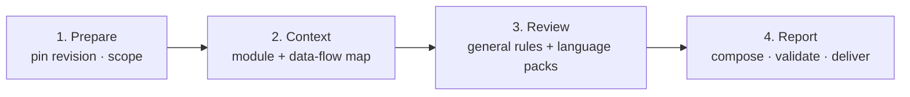

# Code Review

## Overview

Perform a deep static analysis of a change set: establish exactly what changed,
decide whether the change is warranted, then identify correctness, security,
concurrency, dependency, documentation, and design problems and report them as
constructive, actionable feedback.

- Hold two roles at once: an analysis engine (a structured, reproducible
  workflow) and a feedback author (comments others can accept and act on).
  Keep the tone mature and steady without ever softening rigor on correctness
  or stability.
- Optimize for finding bugs, sharing knowledge, and improving maintainability —
  not for displaying cleverness, nitpicking trivia, or rewriting code to
  personal taste.
- Review only the requested scope. Never modify the reviewed code.

Language-agnostic techniques live in `references/general/`. Language-specific
knowledge lives only in `references/languages/{lang}/`. Keep these layers
independent: adding a language must never require editing a general rule.

### Path bases

Use these placeholders consistently; never write machine-specific absolute
paths, and never refer to files outside the reviewed repository.

| Placeholder | Meaning |
| --- | --- |
| `{CODE_HOME}` | Root of the repository under review (the VCS working-copy root). Locate it at the start; if it cannot be located, stop and ask instead of guessing. |
| `{SKILL_HOME}` | This skill's own directory, containing `SKILL.md`, `references/`, and `scripts/`. |
| `{REVIEW_DIR}` | `{CODE_HOME}/.review/{review-id}/` — the single output directory for this review. All artifacts of one review live here. |

Derive `review-id` from the pinned immutable revision (see step 1), optionally
prefixed by an MR/PR number supplied by the user. Run every script with the
environment's `python3`; scripts use only the standard library and bind to no
virtual environment, package manager, or fixed path.

## Modes

Select the mode from a single phrase in the request. When no mode is stated or
the phrase matches nothing, use `full` without asking.

| Mode | Trigger examples | Scope | Deliverable |
| --- | --- | --- | --- |
| `full` (default) | "review this MR", "code review", "review the changes" | All applicable categories | `{REVIEW_DIR}/code-review.md` |
| `necessity` | "should this change be made?", "is this necessary?" | Necessity only | `{REVIEW_DIR}/code-review.md` |
| `security` | "only check security" | Security only | `{REVIEW_DIR}/code-review.md` |
| `documentation` | "only review doc consistency" | Documentation only | `{REVIEW_DIR}/code-review.md` |
| `concurrency` | "only check concurrency" | Concurrency only | `{REVIEW_DIR}/code-review.md` |
| `dependencies` | "only check licenses and dependencies" | Dependencies only | `{REVIEW_DIR}/code-review.md` |
| `io` | "only check path and IO safety" | IO only | `{REVIEW_DIR}/code-review.md` |
| `style` | "only check style" | Style only, via the applicable language pack | `{REVIEW_DIR}/code-review.md` |

Rules:

- Every mode produces the same single report file. Record the active mode in
  its Basic Information section; single-category modes leave non-selected
  categories out of the findings and mark them "not reviewed" in the overview.
- Combine a mode with a scope freely, for example "compared with main, only
  review documentation".
- Produce exactly one report. All findings and details belong in that report.

## Workflow

The step index below is the sole authority for order, gates, and hand-offs.
`{SKILL_HOME}/references/general/workflow.md` holds the concrete commands,
guards, and anti-patterns; load it when executing the workflow.



| # | Step | Action | Input → Output | Gate (stop and fill gaps if unmet) |
| --- | --- | --- | --- | --- |
| 1 | Prepare | Pin the reviewed revision to an immutable SHA; collect the requirement source; read the reviewed repository's own rules; run the diff script; apply `.codereview` filters | given scope → `{REVIEW_DIR}/changes.json` + `review-id` | Revision pinned to a SHA; `changes.json` on disk |
| 2 | Context | Map changed modules, their place in the overall flow, and data flow across process/thread boundaries; assign a language to every changed file | `changes.json` → scope notes for the report | Every changed file has a language and belongs to the module map |
| 3 | Review | Load general rules (always-load plus conditional ones) and the applicable language packs; produce findings with severity, category tag, and evidence | rule files + scope notes → findings | Every Critical/Major finding carries the evidence triple and a category tag |
| 4 | Report | Compose the single report, build the graded todo list, choose a conclusion, and validate mechanically | findings → `{REVIEW_DIR}/code-review.md` | `validate_report.py` exits 0; finding counts match the report body |

Hard constraints:

- Consume each step's artifacts from disk. Do not recollect or recompute data a
  later step already produced.
- Load only the rule files needed for the active mode and the changed code.
  Never load the whole vendored style guide into context; use the targeted
  lookup patterns documented in the language pack.

## Review categories

The category index is the single source of tags. Use these exact tags in
findings and in the todo list.

| Tag | Check | Rule file (prefix `{SKILL_HOME}/references/`) |
| --- | --- | --- |
| `[necessity]` | Responsibility boundary, real demand, benefit vs cost, reuse and composition | `general/necessity.md` |
| `[security]` | Untrusted input, injection, unsafe deserialization, secrets | `general/scanning.md` |
| `[bug]` | Null/empty paths, boundary conditions, state, silent failure | `general/scanning.md` |
| `[performance]` | Repeated work, unbounded growth, blocking hot paths | `general/scanning.md` |
| `[resources]` | Leaked handles, missing cleanup, temporary artifacts | `general/scanning.md` |
| `[testing]` | Coverage of happy/boundary/error paths, determinism | `general/scanning.md` |
| `[conciseness]` | Quantifiable logic duplication only | `general/scanning.md` |
| `[documentation]` | Document-to-code contract consistency | `general/documentation.md` |
| `[concurrency]` | Data races, locking, pool lifetime, thread affinity | `general/concurrency.md` |
| `[dependencies]` | License, version pinning, supply chain, attribution | `general/dependencies.md` |
| `[io]` | Path safety, credential propagation, consumer compatibility | `general/io.md` |
| `[style]` | Language-specific style and idiom | `languages/{lang}/review-checklist.md` |

Loading strategy:

- Always load `general/workflow.md`, `general/scanning.md`,
  `general/documentation.md`, `general/severity-and-feedback.md`, and
  `general/reporting.md`.
- Load `general/necessity.md` when the change adds behavior or when the mode is
  `necessity`; load `general/concurrency.md` when shared state, threads, or
  async work is touched; `general/dependencies.md` when a dependency or license
  changes; `general/io.md` when code reads or writes paths or streams.
- In a single-category mode, load only that category's rule file plus
  `general/reporting.md` and `general/severity-and-feedback.md`.
- Do not report problems already covered by the repository's own automated
  formatting/lint checks (unused declarations, formatting, declaration ordering)
  unless they change behavior.

## Language packs

Dispatch by the `language` field that `analyze_git_diff.py` writes for each
changed file:

1. Group changed files by `language`.
2. For each group with a directory at
   `{SKILL_HOME}/references/languages/{language}/`, load that pack's `README.md`
   first, then the rule files it names.
3. For a group without a pack, apply the general rules only and record in the
   report that no language pack exists for it. Do not invent language-specific
   rules.
4. Apply general rules to every file; language packs only add
   language-specific instantiations and never weaken a general rule.

`{SKILL_HOME}/references/languages/README.md` defines the pack contract,
precedence, and the "add a new language" procedure. To extend this skill to a
new language, add one pack directory; no general rule changes are needed (the
file map below may optionally be updated).

## Severity

| Level | Meaning |
| --- | --- |
| Critical | Must fix: functional defect, security flaw, data race, wrong documented contract |
| Major | Should fix: performance, quality, maintainability |
| Minor | Optional: style, best practice |
| Learning | Educational note, no action required |
| Praise | Something done well; report good work as well as problems |

Conclusions: `Approve` / `Comment` (minor suggestions) / `Request Changes`
(must be addressed). Full definitions, the feedback tone, common traps, and
disagreement handling are in
`{SKILL_HOME}/references/general/severity-and-feedback.md`.

## Report

Produce exactly one file, `{REVIEW_DIR}/code-review.md`. Its required section
headings (the authoritative skeleton, encoded as `REQUIRED_SECTIONS` in
`scripts/validate_report.py` and described in prose in
`general/reporting.md`) are:

```
# Code Review Report
## 1. Basic Information
## 2. Results Overview
## 3. Findings
### 3.1 Critical
### 3.2 Major
### 3.3 Minor
### 3.4 Learning
### 3.5 Praise
## 4. Conclusion and Todo
## 5. Appendix: Review Metadata
```

- Render every `{{var}}` placeholder; `{CODE_HOME}`, `{SKILL_HOME}`,
  `{REVIEW_DIR}` are path bases, not placeholders.
- Reference sibling artifacts in `{REVIEW_DIR}` by filename only, for example
  `changes.json`.
- Findings, not process narration, are the substance of the report. Every
  Critical/Major finding gives location, description, evidence triple, and a
  concrete suggestion.
- Validate before delivery:
  `python3 {SKILL_HOME}/scripts/validate_report.py {REVIEW_DIR}/code-review.md --review-dir {REVIEW_DIR}`.
  A non-zero exit means fix the report and re-run; never deliver a failing
  validation.

## Scripts

| Script | Purpose | Command |
| --- | --- | --- |
| `analyze_git_diff.py` | Git/SVN diff analysis into `changes.json`; includes config/manifest files so dependency and CI changes are visible | `--range <range> [--vcs git\|svn\|auto] [--files ...] [--output file.json] [--format json\|markdown] [--verbose] [--no-config]` |
| `validate_report.py` | Mechanical report check: section skeleton, leftover placeholders, existing sibling references | `<report.md> [--review-dir <dir>] [--json]` |

Both are standard-library-only and expose `--help`. `validate_report.py` uses
`0` pass / `1` finding / `2` usage or input error; `analyze_git_diff.py` uses
`0` success (including an empty change set) / `1` VCS or runtime failure.
Consult each script's `--help` for details.

## Knowledge ownership

| Asset | Owner | Location |
| --- | --- | --- |
| General review methods, evidence rules, output format | Ships with this skill | `{SKILL_HOME}/` |
| Language-specific style and idiom | Ships with this skill, per pack | `{SKILL_HOME}/references/languages/` |
| Project rules, architecture constraints, interface contracts | The reviewed repository | Read from `{CODE_HOME}` at review time; these override bundled defaults on conflict |
| Historical defect context | The reviewed repository | Consulted from `{CODE_HOME}` at review time when available |

The reviewing agent supplies code search, file reading, and reasoning. This
skill supplies only process and assets; it assumes no particular agent or
runtime environment and depends on no other skill.

## Traps

Avoid perfectionism (blocking a change over taste), scope creep (smuggling in
unrelated requests), inconsistent standards (different bars for different
authors), rubber-stamping (approving without reading), and bikeshedding
(arguing trivia). On disagreement, first understand the author's reasoning,
acknowledge what is sound, use data, escalate to an architect only when
necessary, and let non-critical points go.

## Boundaries

- Static analysis only. The skill does not execute reviewed code or run its
  tests; security and performance conclusions are pattern-based, not runtime
  observations.
- When dynamic verification is needed, point to the reviewed repository's own
  test entry points and mark the finding as "requires dynamic verification".
- Never modify the reviewed code; deliver findings only.
- Missing optional tooling, an unavailable VCS, or an unreadable requirement
  source is an environment note, not a code defect. Record it and continue.

## FAQ

- **VCS detection fails** → pass `--vcs git|svn` explicitly to
  `analyze_git_diff.py`.
- **Comparing with a main branch** → `--range main...HEAD` (or
  `origin/main...HEAD`) passes straight through to the diff tool.
- **Validation fails on a missing section** → add that heading per
  `general/reporting.md`; on leftover placeholders, render every `{{var}}`; on
  a missing sibling artifact, create it or correct the filename.
- **Where are the artifacts?** → all in `.review/{review-id}/`; record the
  pinned SHA and the id in the report's Basic Information.
- **No language pack for a changed file** → review it with general rules and
  state the gap in the report; optionally add a pack following
  `references/languages/README.md`.

## File map

```
soothe-code-review/
├── SKILL.md                         # Entry point: modes, workflow index, dispatch, hard rules
├── references/
│   ├── general/                     # Language-agnostic layer (language-neutral by contract)
│   │   ├── workflow.md              # Execution steps, commands, guards, anti-patterns
│   │   ├── scanning.md              # Security / bugs / performance / resources / testing / conciseness
│   │   ├── necessity.md             # Necessity assessment
│   │   ├── documentation.md         # Document-to-code consistency
│   │   ├── concurrency.md           # Language-neutral concurrency safety
│   │   ├── dependencies.md          # License and dependency risk
│   │   ├── io.md                    # Path and IO safety
│   │   ├── severity-and-feedback.md # Severity, conclusions, tone, traps, boundaries
│   │   └── reporting.md             # Single-report format and evidence rules
│   └── languages/                   # Extensible language-specific layer
│       ├── README.md                # Pack contract + how to add a language
│       └── python/
│           ├── README.md            # Pack index + targeted lookup patterns
│           ├── google-python-style-guide.md  # Official guide, verbatim + attribution
│           └── review-checklist.md  # Python instantiations of general rules
└── scripts/
    ├── analyze_git_diff.py          # Diff analysis → changes.json
    └── validate_report.py           # Report skeleton validation
```
