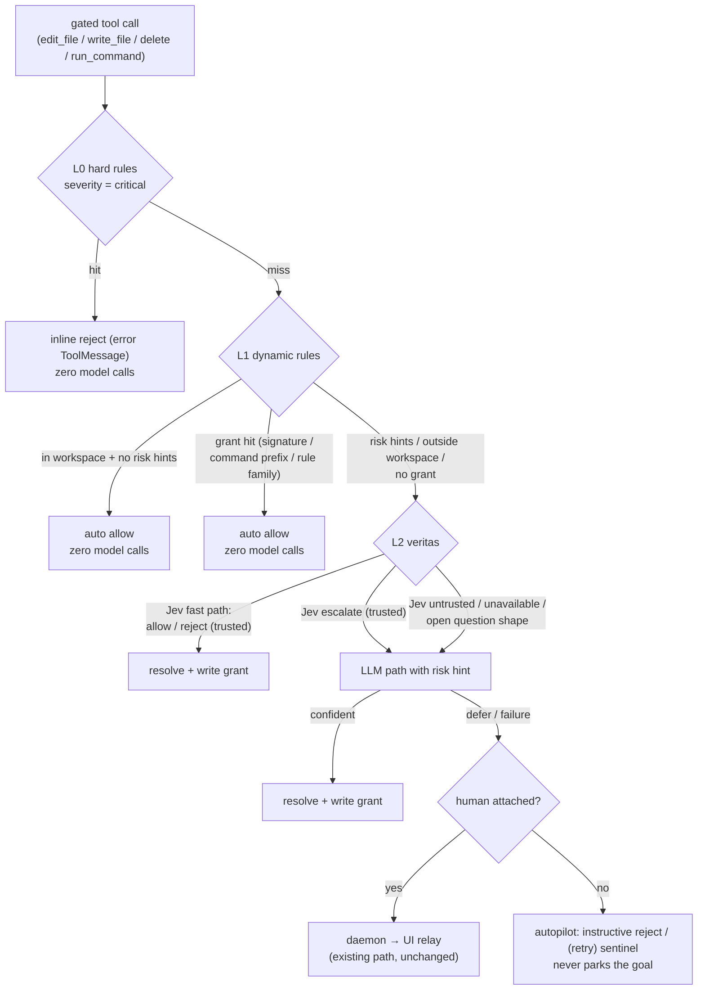

# IG-LOOP-014: Risk-Tiered Security, Loop Grants, and the Veritas Decision Fast Path

Cross-repo implementation guide: `soothe-nano` (rule registry) + `soothe`
(decision policy). `soothe-daemon` is untouched.

## Problem

Soothe is evolving toward fully autonomous loops (autoresearch). Two things
block that today:

1. **Model-call flood for risk judgment.** `AutoModeMiddleware._apply_classification`
   sends *every* rule-unresolved (`default_approve`) gated tool call to the
   Jev classifier (`sloop/clarification/risk_classifier.py`). A loop that
   edits fifty files and runs thirty commands pays eighty classifier calls,
   none of which carry information — the actions were ordinary in-workspace
   mutations that any cheap deterministic check would clear.

2. **Untiered security rules.** Two rule sets hard-deny everything they
   match, with no notion of risk level, and Jev/veritas never get a chance
   to judge the middle ground:
   - nano `soothe_nano/security/operation_guard.py`: 26 banned command
     patterns, bypass-immune dangerous path components, sensitive system
     paths, workspace boundary — all `verdict="deny"`.
   - soothe `config/models.py::_default_deny_rules`: 20 built-in rules
     (command + path), duplicating nano's coverage in places (`sudo`,
     `chmod -R 777 /`, `/etc/**` writes).

3. **Two separate model seams.** Jev (calibrated decision model, TypeSafe
   `Choice`) is wired into the middleware; veritas (LLM subagent) is wired
   into `AskUserGateMiddleware`, the station policy, and the rail pause
   gate. Two wiring paths, two confidence vocabularies, no shared fast
   path.

Goals (operator decisions, all settled):

- Keep the daemon → UI clarification relay exactly as-is; it remains the
  guaranteed delivery path when a human is attached (e.g. skill-triggered
  clarifications).
- Eliminate clarifications from soothe's internal logic as far as possible;
  headless autopilot must never park a goal in `awaiting_clarification`.
- Security rules: keep only the highest risk level (critical) as hard
   denies; everything else becomes a risk hint judged dynamically.
- Jev and veritas are fallbacks only. Dynamic rule handling resolves the
   bulk of actions with zero model calls.
- Jev is inherited *into* veritas as a built-in fast path: Jev first, LLM
  second; when Jev is inapplicable or unusable, fall straight to the LLM.
- nano defaults to critical-only hard denies — uniformly for **all**
  downstream consumers (soothe, flowjet, agentspace, miracloud images).

## Solution

### The four-layer funnel



### Part 1 — nano: one tiered rule registry

**Severity model.** Every security rule gets a severity: `critical`,
`high`, or `medium`. Evaluation maps severity through a configurable hard
set:

- severity ∈ `hard_deny_severities` → `verdict="deny"` (as today)
- otherwise → `verdict="risk_hint"`, carrying `rule_id`, `severity`, and
  the match reason

**Default: `hard_deny_severities = {"critical"}`** for every consumer.
Downstream consumers without a judgment layer (flowjet, agentspace) treat
`risk_hint` as **allow-with-audit**: the action executes, but the decision
carries the rule id / severity and emits a warning-level log line, so the
posture change is observable and attributable. Hosts that want to tighten
set `hard_deny_severities` themselves.

**Severity assignments** (final table lives in the code; reviewed at
implementation):

| Rule (nano) | Severity | Notes |
|---|---|---|
| `command.dangerous.rm_root`, `sudo_rm_rf` | critical | irreversible system destruction |
| `command.dangerous.mkfs`, `dd_block_device_write`, `fork_bomb` | critical | |
| `command.dangerous.pipe_to_shell` (`curl\|sh`) | critical | |
| `command.dangerous.system_path_redirect`, `system_path_tee` | critical | |
| `command.dangerous.chmod_root` (`chmod -R 777 /`), `chown_root` | critical | system-wide permission destruction |
| `command.dangerous.kill_daemon_port`, `kill_soothed_pidfile`, `kill_pgrep_soothe`, `pkill_soothe`, `killall_soothe`, `soothed_lifecycle`, protected-kill hook | critical | daemon self-protection family |
| `filesystem.sensitive_system_path` on **write** | critical | `/etc/**`, `/bin/**`, `/usr/**`, `/System/**`, … |
| `filesystem.workspace_boundary` on **write** | critical | sandbox root; `allow_paths_outside_workspace` config unchanged |
| `command.dangerous.rm_rf`, `rm_r` (non-root targets) | high | |
| `command.dangerous.sudo` (bare), `dd` (read side) | high | |
| `command.dangerous.chmod_777`, `shred`, `git_force_push` | high | |
| `filesystem.dangerous_component` on **write** (`.git`, `.env*`, shell rc, …) | high | |
| `filesystem.dangerous_component` on **read** | medium | |
| `filesystem.sensitive_system_path` on **read** | medium | |
| `filesystem.workspace_boundary` on **read** | high | |
| Operator-configured matches (`denied_paths`, `denied_file_types`, `allowed_paths` miss) | critical | explicit operator intent stays absolute |
| `filesystem.filetype_approval` | need_approval (unchanged) | already an escalation verdict |

**Migration: soothe built-ins → nano.** `_default_deny_rules` is deleted
from soothe. Command rules migrate into the nano registry as regex entries
(nano matches with unanchored `re.search` over the whole command string —
strictly more conservative than soothe's every-subcommand-must-match
semantics, so no coverage gap). Path rules (`/etc/**` etc. writes) are pure
duplicates of nano's sensitive system path patterns and are dropped
outright.

| soothe pattern | nano regex | Severity |
|---|---|---|
| `su *` | `\bsu(\s|$)` | high |
| `doas *` | `\bdoas(\s|$)` | high |
| `chmod -R *` | `\bchmod\s+-[a-zA-Z]*R` | high |
| `chown -R *` | `\bchown\s+-[a-zA-Z]*R` | high |
| `chgrp -R *` | `\bchgrp\s+-[a-zA-Z]*R` | high |
| `fdisk*` | `\bfdisk\b` | high |
| `diskutil*` | `\bdiskutil\b` | high |
| `shutdown *` | `\bshutdown\b` | high |
| `reboot *` | `\breboot\b` | high |
| `halt *` | `\bhalt\b` | high |
| `apt *` | `\bapt\b` | high |
| `apt-get *` | `\bapt-get\b` | high |
| `brew *` | `\bbrew\b` | high |
| `npm install -g*` | `\bnpm\s+(install\|i)\s+(-g\|--global)\b` | high |

soothe keeps **one** extension point: user-configured
`tool_approval.deny_rules` (soothe.yml), still evaluated first in the
pipeline and always treated as critical. `tool_rule_matcher.py` (exact /
prefix / wildcard matching) serves only that purpose from now on.

### Part 2 — soothe: the veritas decision fast path (Jev first, LLM second)

`build_veritas_answerer` is already the single source of truth shared by
`AskUserGateMiddleware`, the station `AutoClarificationPolicy`, and the
rail pause gate. The Jev classifier moves *inside* it, so all three
consumers inherit the fast path for free.

```
answer(request):
  1. Applicability: does the request carry a decision subject
     (metadata["decision_subject"] = {tool, args_preview}, set by the
     middleware; goal summary from loop_state)? Open question shapes
     (plain ask_user) have no subject → skip to the LLM path.
  2. Jev fast path (TypeSafe Choice, calibrated + drift gates):
     - band=allow   (trusted) → synthetic answer "approve", source="decision_model"
     - band=reject  (trusted) → synthetic answer "deny",   source="decision_model"
     - band=escalate(trusted) → LLM path, with the risk hint embedded in
       the user prompt (the LLM sees goal + loop context and decides)
     - untrusted / unavailable / timeout / error → LLM path
  3. LLM path: the existing structured-output call, unchanged.
```

Semantics notes:

- "Jev inapplicable" covers both shapes: requests with no decision
  subject, and verdicts the trust gates reject (low confidence / near-tie
  / transport failure). Both fall to the LLM without penalty.
- Jev's `escalate` does **not** go straight to a human. The LLM is the
  contextual decider; the human relay is reached only when the LLM also
  defers.
- Dual confidence vocabularies: Jev answers are already gated by the
  classifier's `trusted()` / `decisive()` checks, so the policy's
  `min_confidence` re-check applies only to `source="llm"` results.
  Decision-model answers carry their calibrated confidence for audit.
- `VeritasAnswerSchema` gains `source: Literal["llm", "decision_model"]
  = "llm"`. The station policy copies it into the answer audit; grant
  write-back uses it as provenance.
- Honest cost: a trusted `escalate` pays Jev + LLM. That is the intended
  division of labor (calibrated cheap screen → contextual decider), and
  the grant write-back (Part 3) ensures each shape pays once per loop.

Module move: `sloop/clarification/risk_classifier.py` →
`subagents/veritas/decision_model.py` (ownership made explicit; provider
resolution still goes through nano's `classifier` config block and
`typesafe` provider kwargs). All existing call sites update.

### Part 3 — soothe: loop-scoped grants (dynamic rule layer)

New module `sloop/clarification/dynamic_rules.py` with a `LoopGrantStore`
riding the existing loop allowlist lifecycle (the configurable-scoped list
from IG-LOOP-009 — cleared when the loop ends):

- **Unifies the record schema.** Human approval records
  (`{"tool", "signature"}`, `{"rule", ...}`) migrate into grant records
  with `source="human"`; the duplicated matching helpers
  (`_matches_allowlist`, `rule_approved`) are deleted in favor of the
  store's matcher. `rule_family()` stays in nano (rule identity lives
  there); the store imports it.
- **Grant record:**
  `{"tool", "match": "signature" | "prefix" | "family", "value",
  "source": "human" | "decision_model" | "llm"}`.
  - `signature`: exact path or exact command (human approvals today).
  - `prefix`: command first-token(s) prefix — the generalization Jev/LLM
    approvals write back (approve one `pytest ...` → subsequent
    `pytest ...` calls clear at L1).
  - `family`: nano rule family (existing human override semantics).
- **Write-back points:** `AutoModeMiddleware` writes a prefix/family grant
  after a veritas approve; the executor's human-approval path writes
  signature/rule grants as today, retagged `source="human"`. Only
  allow-verdicts are written back; denies stay per-call (an instructive
  reject already teaches the LLM not to retry).
- **Bounds:** cap of 256 grant records per loop (oldest evicted); no TTL
  needed (loop-scoped).
- **Negative-cache / hint routing input:** the pipeline's `ApprovalResult`
  gains `risk_hints: tuple[str, ...]` (rule ids from nano `risk_hint`
  matches) and `in_workspace: bool`, computed during evaluation. The
  middleware routes to veritas only when the dynamic layer is unresolved:
  hints present, outside workspace, or no grant hit. In-workspace,
  hint-free, un-granted mutations that reach `default_approve` are simply
  allowed — **that is the model-call elimination**.

### Part 4 — soothe: pipeline and middleware rewiring

- `AutoModeMiddleware`:
  - Constructor drops `classifier` / `classifier_config`; gains
    `veritas_answer` (the shared answerer, built once alongside
    `AskUserGateMiddleware`'s) and the autopilot flags.
  - `_apply_classification`, `_is_ambiguous`, `_args_preview`, and
    `_classifier_reject_message` are deleted (dead-code rule). The new
    async path `_resolve_ambiguous` builds a `ClarificationRequest`
    (origin `tool_approval`, `decision_subject` in metadata) for
    L1-unresolved calls, awaits veritas, and maps: approve → allow +
    grant write-back; deny → instructive reject (`_reject_message`);
    defer → interrupt when a human is attached, else the existing
    autopilot degrade (instructive reject / `(retry)` sentinel parity).
  - Deterministic stages stay synchronous and inline in `after_model`;
    only the veritas leg is async.
- `ToolApprovalPipeline`:
  - Stage 1 evaluates **user-configured** deny rules only (always
    critical).
  - Stage 3 (nano safety) now returns risk hints for sub-critical
    matches; hard set comes from `SecurityConfig.hard_deny_severities`.
  - `ApprovalResult` extended as in Part 3; `escalate` is redefined as
    "hand to the dynamic layer", not "find a human".
- Station `AutoClarificationPolicy._answer_tool_approval`: unchanged. An
  interrupt reaching the station now means veritas already deferred with a
  human attached — routing to the relay is exactly right.
- daemon → UI relay: zero changes.

## Changes

### soothe-nano

- `src/soothe_nano/security/operation_guard.py`
  - Severity-tag every rule (command patterns, path components, system
    paths, boundary, config-driven matches).
  - `OperationSecurityDecision` gains `severity`; new `risk_hint` verdict
    for sub-hard-set matches.
  - `SecurityConfig` gains `hard_deny_severities` (default
    `{"critical"}`).
  - Absorb the migrated command rules from the table above.
  - Allow-with-audit: `risk_hint` decisions log a warning line with
    rule id + severity at the enforcement points
    (`security_enforcer.py`, tool backends).
- `src/soothe_nano/protocols/operation_security.py`: decision model field.
- `src/soothe_nano/config/models.py`: `hard_deny_severities` on
  `SecurityConfig`.
- Tests: severity table, risk_hint mapping, default hard set,
  allow-with-audit logging, protected-kill criticality, migrated patterns
  (including compound commands and `cd x && sudo …` shapes).

### soothe

- `packages/soothe/src/soothe/subagents/veritas/decision_model.py` (new;
  relocated from `sloop/clarification/risk_classifier.py`)
- `packages/soothe/src/soothe/subagents/veritas/implementation.py`
  - Fast path in `answer()`; risk-hint prompt augmentation for the
    escalate → LLM leg; `source` propagation.
- `packages/soothe/src/soothe/subagents/veritas/schemas.py`
  - `VeritasAnswerSchema.source`.
- `packages/soothe/src/soothe/sloop/clarification/dynamic_rules.py` (new)
  - `LoopGrantStore`, grant matching, prefix generalization, cap.
- `packages/soothe/src/soothe/sloop/clarification/tool_approval_pipeline.py`
  - User-rules-only Stage 1; risk-hint surfacing; `ApprovalResult`
    extension; grant-store integration (delete duplicated allowlist
    helpers).
- `packages/soothe/src/soothe/sloop/middleware/auto_mode.py`
  - Delete the classifier path; add the veritas leg per Part 4.
- `packages/soothe/src/soothe/coreagent/builder.py`
  - Build the shared veritas answerer once; wire into
    `AutoModeMiddleware`; remove `build_risk_classifier` wiring.
- `packages/soothe/src/soothe/config/models.py`
  - `_default_deny_rules` deleted (`deny_rules` defaults to empty).
  - `ToolApprovalConfig.dynamic_rules` (enabled, grant cap, prefix
    generalization).
  - `agent.veritas.decision_fast_path` (enabled default `True`).
  - `classifier` block unchanged (provider reference).
- Executor allowlist write sites: retag human approvals as grants.
- Docs: `.platonic/specs/loop/` RFC companion summarizing the posture
  change (see Follow-ups).

## Tests

- **Model-call budget assertions (the point of this IG):**
  - 100 in-workspace, hint-free, un-granted gated calls → 0 veritas / 0
    Jev invocations (all resolve at L1).
  - After one veritas approve of `pytest -x ...`, subsequent `pytest …`
    calls → 0 model calls (prefix grant).
  - A call with a `risk_hint` → exactly 1 Jev call; when Jev returns
    untrusted → exactly 1 additional LLM call.
  - A critical rule hit → 0 model calls (inline reject).
- Decision fast path: band mapping (allow/reject/escalate), untrusted →
  LLM fallback, no-subject requests skip Jev, `source` field, dual
  confidence gates (min_confidence applies to LLM only).
- Grant store: prefix generalization, family override, cap eviction,
  loop-end clearing, human record migration.
- Middleware: autopilot never parks (defer → reject / retry sentinel);
  human-attached defer → interrupt reaches the relay.
- Regressions: existing clarification suite (`tests/unit/core/loop/clarification/`,
  `tests/unit/sloop/middleware/`), veritas suite
  (`tests/unit/subagents/veritas/`), tool approval bridge tests.
- Cross-repo: nano unit suite; flowjet / agentspace behavior regression
  (see Release).

## Release and regression

1. nano ships first: severity registry + `risk_hint` + default
   `hard_deny_severities={"critical"}` is a **behavior change** for every
   consumer — CHANGELOG `Changed` entry, version bump on the next release
   train.
2. flowjet / agentspace regression: previously hard-denied actions
   (`git push -f`, `chmod -R`, package installs, `.env`/`.git` component
   writes) become allow-with-audit on their execution planes. Run
   agentspace unit tests + miracloud e2e (workspace fence assertions are
   unaffected — the write boundary stays critical).
3. soothe floor bump lands in the same train; soothe deletes its built-in
   rules only against the new nano floor.
4. soothe-daemon: no changes, no rebuild required.
5. Verification: `./scripts/verify_finally.sh` in soothe; nano full unit
   suite; headless smoke run (goal never parks; grant hit produces zero
   second-call model invocations).

## Follow-ups (out of scope here)

- Session/thread-scoped persistent grants with TTL (recorded as the RFC's
  future work; loop-scoped only in this IG).
- Jev applicability for the rail pause gate (PROCEED/PAUSE is a
  fixed-vocabulary categorical question; the fast path could serve it once
  criteria are generalized beyond action risk).
- RFC-LOOP-0xx spec companion in `.platonic/specs/loop/` documenting the
  security posture change for the spec record.
