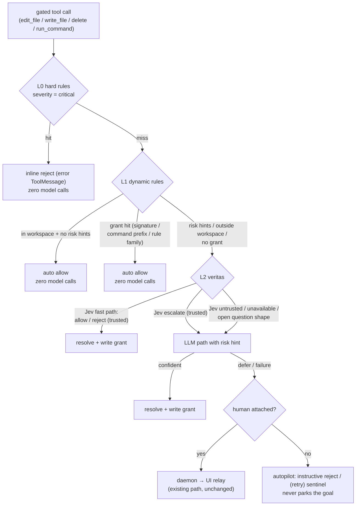

# RFC-LOOP-030: Risk-Tiered Security, Loop Grants, and the Veritas Decision Fast Path

**RFC**: 636
**Title**: Risk-Tiered Security, Loop Grants, and the Veritas Decision Fast Path
**Status**: Proposed
**Kind**: Implementation Interface Design
**Created**: 2026-10-30
**Authors**: Soothe Team
**Depends on**: RFC-CORE-008, RFC-LOOP-023, RFC-LOOP-024, RFC-LOOP-028, RFC-LOOP-029
**Related**: [IG-LOOP-014](../../impl/loop/IG-LOOP-014-risk-tiered-security-and-veritas-decision-fast-path.md) (file-level implementation detail, severity/rule migration tables)

---

## 1. Abstract

Soothe is evolving toward fully autonomous loops (autoresearch). Three things
block that today: every rule-unresolved gated tool call pays a calibrated
classifier invocation regardless of how ordinary it was; the two security rule
sets (nano operation security + soothe built-in deny rules) hard-deny
everything they match with no notion of risk level; and model judgment is
wired through two separate seams (the Jev classifier in the middleware, the
veritas LLM subagent in the gates and station). RFC-LOOP-030 consolidates all
security rules into a severity-tiered nano registry that hard-denies only
`critical` rules, resolves the bulk of actions through a deterministic
dynamic-rule layer (loop-scoped grants), and inherits the Jev decision model
into veritas as a built-in fast path — Jev first, LLM second. The daemon → UI
clarification relay is unchanged and remains the guaranteed human-delivery
path.

---

## 2. Background and Motivation

### 2.1 Model-call flood for risk judgment

`AutoModeMiddleware._apply_classification` sends **every** rule-unresolved
(`default_approve`) gated tool call to the calibrated risk classifier
(`sloop/clarification/risk_classifier.py`, TypeSafe `Choice`, model
`jev-latest`). A loop performing fifty in-workspace edits and thirty ordinary
commands pays eighty classifier calls, none of which carry information. For
24/7 autoresearch loops this is pure cost.

### 2.2 Untiered security rules

- nano `soothe_nano/security/operation_guard.py`: 26 banned command
  patterns, bypass-immune dangerous path components, sensitive system paths,
  workspace boundary — all `verdict="deny"`, no risk levels.
- soothe `config/models.py::_default_deny_rules`: 20 built-in rules
  duplicating nano coverage in places (`sudo`, `chmod -R 777 /`, `/etc/**`
  writes), also flat deny.

Jev and veritas never get a chance to judge the middle ground: any rule hit
is a hard reject or a human escalation.

### 2.3 Two model seams

Jev (calibrated decision model) is wired into the middleware; veritas (LLM
subagent) is wired into `AskUserGateMiddleware`, the station
`AutoClarificationPolicy`, and the rail pause gate. Two wiring paths, two
confidence vocabularies, no shared fast path.

### 2.4 Operator decisions (settled 2026-10-30)

1. Keep the daemon → UI clarification relay exactly as-is — the guaranteed
   delivery path when a human is attached (e.g. skill-triggered
   clarifications).
2. Eliminate clarifications from soothe's internal logic as far as possible;
   headless autopilot must never park a goal in `awaiting_clarification`.
3. Security rules keep only the highest risk level (critical) as hard
   denies; everything else becomes a risk hint judged dynamically.
4. Jev and veritas are fallbacks only — dynamic rule handling resolves the
   bulk of actions with zero model calls.
5. Jev is inherited into veritas: Jev first, LLM second; when Jev is
   inapplicable or unusable, fall straight to the LLM.
6. nano defaults to critical-only hard denies, uniformly for **all**
   downstream consumers (soothe, flowjet, agentspace).

---

## 3. Scope and Non-Goals

**Scope**: the nano rule registry and verdict model; the soothe tool-approval
pipeline, `AutoModeMiddleware`, veritas answerer, and loop-scoped grant store;
the config surface; the model-call budget contract.

**Non-goals**:

- No changes to the daemon → UI relay, the clarification protocol, origins,
  or station routing for non-`tool_approval` origins.
- No session/thread-scoped persistent grants (recorded as future work;
  loop-scoped only).
- No Jev applicability for the rail pause gate (future work).
- No changes to `plan_mode_review` force-manual semantics.

---

## 4. Design

### 4.1 The four-layer funnel



### 4.2 Severity-tiered rule registry (nano)

Every security rule in `soothe_nano/security/operation_guard.py` (command
patterns, dangerous path components, sensitive system paths, workspace
boundary, config-driven matches) is severity-tagged: `critical`, `high`, or
`medium`. `OperationSecurityDecision` carries `severity`. Evaluation maps
severity through `SecurityConfig.hard_deny_severities`:

- severity ∈ hard set → `verdict="deny"` (as today)
- otherwise → `verdict="risk_hint"` carrying `rule_id`, `severity`, reason

Read/write differentiation: several path rules take operation kind into
account — sensitive system paths and the workspace boundary are `critical` on
write but `high`/`medium` hints on read; dangerous path components (`.git`,
`.env*`, shell rc, …) are `high` on write, `medium` on read. Operator-configured
matches (`denied_paths`, `denied_file_types`, allowed-pattern miss) stay
absolute (explicit operator intent). The complete assignment table lives in
IG-LOOP-014 Part 1.

### 4.3 `risk_hint` verdict and the downstream default

**Default: `hard_deny_severities = {"critical"}` for every consumer.**
Consumers without a judgment layer (flowjet, agentspace) treat `risk_hint`
as **allow-with-audit**: the action executes, the decision carries rule id +
severity, and a warning-level log line is emitted at the enforcement points.
The posture change is observable and attributable; hosts that want to tighten
set `hard_deny_severities` themselves.

### 4.4 Rule consolidation into nano

The single rule registry lives in nano. soothe's built-in
`_default_deny_rules` is deleted: command rules migrate into the nano
registry as regex entries (nano's unanchored whole-string `re.search` is
strictly more conservative than soothe's every-subcommand-must-match
semantics — no coverage gap), and the ten path rules are pure duplicates of
nano's sensitive system path patterns. soothe keeps exactly one extension
point: user-configured `tool_approval.deny_rules` in soothe.yml, evaluated
first and always treated as critical; `tool_rule_matcher.py` serves only that
purpose. The migration mapping table lives in IG-LOOP-014 Part 1.

### 4.5 Veritas decision fast path (Jev first, LLM second)

The Jev classifier moves inside `build_veritas_answerer` — the single source
of truth already shared by `AskUserGateMiddleware`, the station policy, and
the rail pause gate — so all three consumers inherit the fast path:

1. **Applicability**: the request must carry a decision subject
   (`metadata["decision_subject"] = {tool, args_preview}`, set by the
   middleware; goal summary from `loop_state`). Open question shapes skip
   Jev.
2. **Jev fast path** (TypeSafe `Choice`, calibrated + drift gates):
   - `allow` (trusted) → synthetic answer `approve`, `source="decision_model"`
   - `reject` (trusted) → synthetic answer `deny`, `source="decision_model"`
   - `escalate` (trusted) → LLM path with the risk hint embedded in the user
     prompt (the LLM sees goal + loop context and decides; it does **not**
     go straight to a human)
   - untrusted / unavailable / timeout → LLM path
3. **LLM path**: the existing structured-output call, unchanged.

"Jev inapplicable" covers both request shapes without a decision subject and
verdicts the trust gates reject. Dual confidence vocabularies: Jev answers
are already gated by the classifier's `trusted()`/`decisive()` checks, so the
policy's `min_confidence` re-check applies only to `source="llm"` results.
`VeritasAnswerSchema` gains `source: Literal["llm", "decision_model"]`.

Module ownership: `sloop/clarification/risk_classifier.py` →
`subagents/veritas/decision_model.py` (provider resolution still via nano's
`classifier` config block).

Honest cost: a trusted `escalate` pays Jev + LLM. That is the intended
division of labor (calibrated cheap screen → contextual decider), and grants
(§4.6) ensure each shape pays once per loop.

### 4.6 Loop-scoped grants

New `sloop/clarification/dynamic_rules.py` with a `LoopGrantStore` riding the
existing loop-allowlist lifecycle (IG-LOOP-009's configurable-scoped list —
cleared when the loop ends):

- Unified record schema:
  `{"tool", "match": "signature" | "prefix" | "family", "value",
  "source": "human" | "decision_model" | "llm"}`. Human approval records
  migrate in with `source="human"`; the duplicated allowlist matching helpers
  are deleted. `rule_family()` stays in nano.
- `prefix` generalization: a veritas approve of one `pytest …` call writes a
  command-prefix grant; subsequent `pytest …` calls clear at L1 with zero
  model calls.
- Write-back: `AutoModeMiddleware` writes prefix/family grants after a
  veritas approve; the executor's human-approval path writes
  signature/rule grants as today. Only allow-verdicts are written back —
  denies stay per-call (an instructive reject already teaches the LLM not to
  retry).
- Bounds: 256 grant records per loop (oldest evicted); loop-scoped, so no
  TTL.

The pipeline's `ApprovalResult` gains `risk_hints: tuple[str, ...]` (rule ids
from nano `risk_hint` matches) and `in_workspace: bool`, computed during
evaluation. The middleware routes to veritas only when L1 is unresolved:
hints present, outside workspace, or no grant hit. In-workspace, hint-free
mutations that reach `default_approve` are simply allowed — that is the
model-call elimination.

### 4.7 Middleware and pipeline rewiring

`AutoModeMiddleware` (RFC-LOOP-028) drops its `classifier` /
`classifier_config` constructor args and the `_apply_classification` path.
The new async leg `_resolve_ambiguous` builds a `ClarificationRequest`
(origin `tool_approval`, decision subject in metadata) for L1-unresolved
calls, awaits the shared veritas answerer, and maps: approve → allow + grant
write-back; deny → instructive reject; defer → interrupt when a human is
attached, else the existing autopilot degrade (instructive reject /
`(retry)` sentinel). `escalate` in the pipeline is redefined as "hand to the
dynamic layer", not "find a human". Station
`AutoClarificationPolicy._answer_tool_approval` is unchanged: an interrupt
reaching the station now means veritas already deferred with a human
attached, so routing to the relay is exactly right.

### 4.8 Config surface

```yaml
agent:
  clarification:
    tool_approval:
      deny_rules: []            # user-defined only; built-ins live in nano
      dynamic_rules:
        enabled: true
        grant_cap: 256
        prefix_generalization: true
    ask_user_gate: {enabled: true}   # unchanged
  veritas:
    decision_fast_path:
      enabled: true             # Jev-first inside the answerer
  classifier: {...}             # unchanged provider block (typesafe)
```

nano `SecurityConfig` gains `hard_deny_severities` (default
`{"critical"}`).

### 4.9 Observability

- Verdict log lines gain `severity` and `hints` fields; `risk_hint`
  allow-with-audit decisions log a warning at the nano enforcement points.
- Grant write-backs log `[grant] tool=... match=... source=...`.
- The model-call budget (§5) is asserted in tests and observable via the
  existing `[veritas] call_stat` aggregation (decision-model answers log
  `source=decision_model`).

---

## 5. Model-Call Budget (normative)

1. 100 in-workspace, hint-free, un-granted gated calls → **0** veritas / Jev
   invocations (all resolve at L1).
2. After one veritas approve of `pytest -x …`, subsequent `pytest …` calls →
   **0** model calls (prefix grant).
3. A call with a `risk_hint` → exactly **1** Jev call; an untrusted Jev
   verdict → exactly **1** additional LLM call.
4. A critical rule hit → **0** model calls (inline reject).

---

## 6. Relationship to Other RFCs

- **RFC-CORE-008**: `OperationSecurityDecision` gains `severity`; the verdict
  set gains `risk_hint`; `hard_deny_severities` defaults to `{"critical"}`.
  The protocol interface is otherwise unchanged.
- **RFC-LOOP-023**: the clarification relay architecture is unchanged;
  `tool_approval` decisions now flow through the four-layer funnel. The
  daemon → UI relay is untouched.
- **RFC-LOOP-024**: veritas keeps its structured-output contract and defer
  taxonomy; the decision fast path runs before the LLM call and tags results
  with `source`.
- **RFC-LOOP-028**: Phase 2 (the classifier extension point) is realized by
  this RFC — as a veritas leg rather than a direct classifier consult in the
  gate.
- **RFC-LOOP-029**: unchanged; `AskUserGateMiddleware` inherits the fast path
  for gate-shaped requests through the shared answerer.

---

## 7. Release and Regression

1. nano ships first — severity registry + `risk_hint` + default
   `hard_deny_severities={"critical"}` is a behavior change for every
   consumer (CHANGELOG `Changed`, next release train).
2. flowjet / agentspace regression: previously hard-denied actions (`git
   push -f`, `chmod -R`, package installs, `.env`/`.git` component writes)
   become allow-with-audit on their execution planes. Workspace fence
   assertions are unaffected (write boundary stays critical).
3. soothe floor bump in the same train; soothe deletes its built-in rules
   only against the new nano floor.
4. soothe-daemon: no changes.

---

## 8. Open Questions / Future Work

- Session/thread-scoped persistent grants with TTL and upper bounds.
- Jev applicability for the rail pause gate (PROCEED/PAUSE is a
  fixed-vocabulary categorical question; generalizing the classifier
  criteria beyond action risk would let the fast path serve it).
- Negative caching of deny verdicts (currently per-call by design).

---

## Changelog

- 2026-10-30: Initial version. Design settled with the operator (Tier-0
  boundary, nano default critical-only for all consumers, loop-scoped
  grants, Jev inherited into veritas). Implementation guide:
  IG-LOOP-014.
